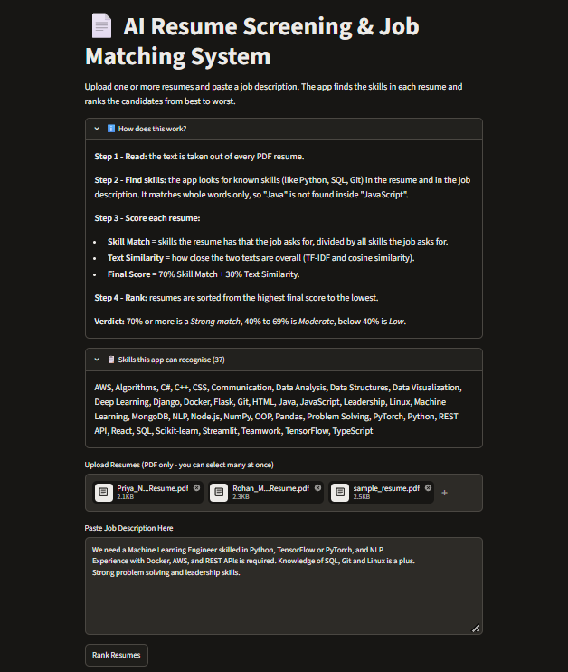
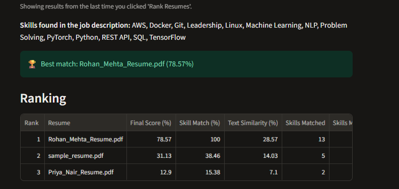
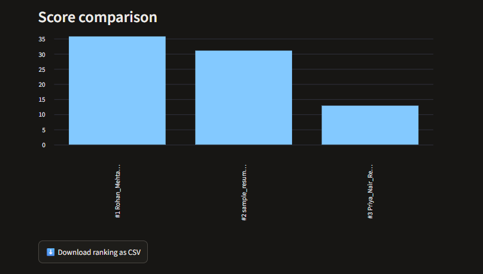
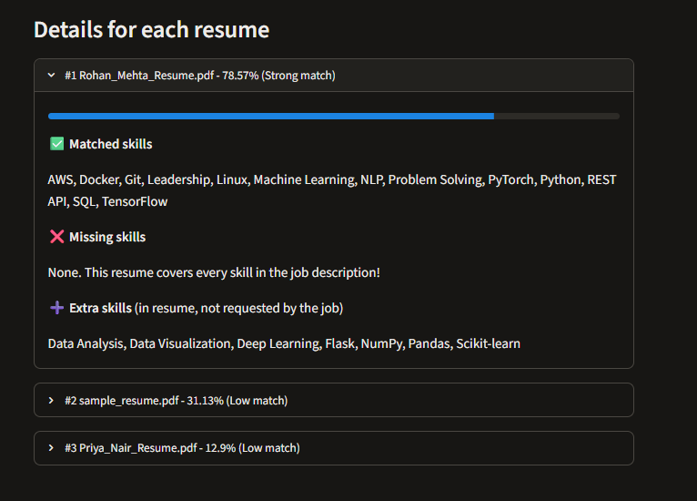

# AI Resume Screening & Job Matching System

A web application that reads PDF resumes, finds the skills in them, compares them
with a job description, and **ranks the candidates** from best to worst match.
Built with Python and Streamlit as a mini project for Computer Science Engineering.

## Features
- Upload **one or many** PDF resumes at once
- Paste any job description
- Automatic **skill extraction** (37 skills across programming, web, data/AI, tools and soft skills)
- Shows **matched**, **missing** and **extra** skills for every resume
- **Ranking table** with final score, skill match, text similarity and a verdict
- **Bar chart** comparing all candidates
- **Download the ranking as a CSV** file (opens in Excel)

## How it works
1. **Read** the text from every PDF resume (PyPDF2).
2. **Find skills** in the resume and the job description by whole-word matching
   with a skills database (so "Java" is not found inside "JavaScript").
3. **Score** each resume:
   - **Skill Match (%)** = skills the resume has that the job asks for / all skills the job asks for
   - **Text Similarity (%)** = TF-IDF vectors compared with cosine similarity (scikit-learn)
   - **Final Score (%)** = 70% x Skill Match + 30% x Text Similarity
4. **Rank** the resumes by final score.

| Final score | Verdict |
|---|---|
| 70% or more | Strong match |
| 40% to 69% | Moderate match |
| Below 40% | Low match |

## Tech stack
| Part | Tool |
|---|---|
| Language | Python 3 |
| Web interface | Streamlit |
| PDF reading | PyPDF2 |
| Text matching (TF-IDF, cosine similarity) | scikit-learn |
| Tables and chart data | pandas (installed together with Streamlit) |

## Project structure
```
resume_matcher/
|-- app.py              # the whole application (skills database, scoring, web page)
|-- requirements.txt    # libraries needed to run the project
|-- README.md           # this file
|-- screenshots/        # screenshots of the application (shown below)
```

## How to run
1. Install Python (python.org) and VS Code (code.visualstudio.com).
2. Open this folder in VS Code (File > Open Folder).
3. Open the terminal (Terminal > New Terminal) and install the libraries:
   ```
   pip install -r requirements.txt
   ```
4. Start the website:
   ```
   python -m streamlit run app.py
   ```
5. Your browser opens at `http://localhost:8501`.

## How to use
1. Upload one or more resumes (PDF files where the text can be selected).
2. Paste a job description.
3. Click **Rank Resumes**.
4. Read the ranking, check the chart, open each resume to see its skills,
   and download the CSV if you need it.

## Example results
Test with three sample resumes (a general developer, a machine learning student
and a web developer). The best candidate changes with the job description:

| Job description | Best match | Score |
|---|---|---|
| Software Developer Intern (Python, SQL, Flask, Git) | General developer | 80.85% |
| Machine Learning Engineer (TensorFlow, NLP, Docker) | Machine learning student | 78.57% |
| Frontend Developer (HTML, CSS, JavaScript, React) | Web developer | 81.27% |

## Screenshots
### Upload resumes and job description


### Ranking table


### Score comparison chart and CSV download


### Skill details for each resume


## Limitations
- Only recognises the skills listed in the `SKILLS` dictionary in `app.py`
  (you can add more skills there easily).
- Works with PDFs that contain real text. Scanned image PDFs cannot be read.
- Matches words, not meaning (for example "ReactJS" is only recognised as React
  because it is listed as an alias in the skills database).

## Future improvements
- Use sentence embeddings (Sentence-BERT) to understand meaning, not only words
- Support DOCX resumes
- Extract experience (years) and education
- Save results in a database

## Author
Mini project - Computer Science Engineering, 5th semester.
